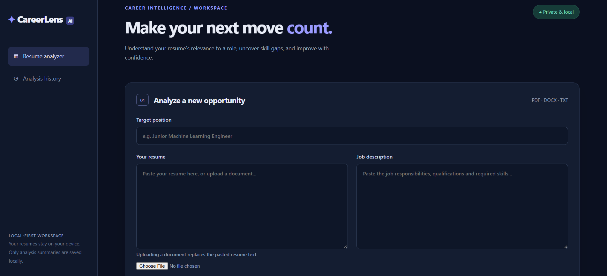
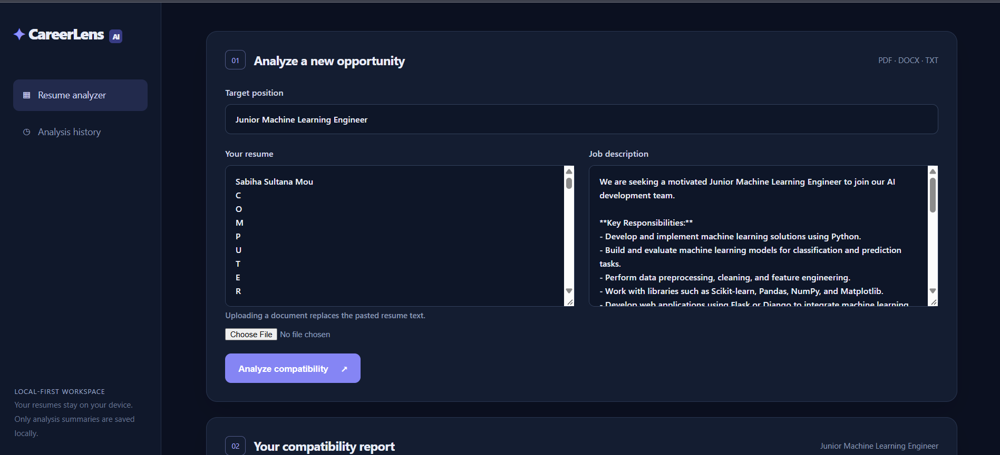
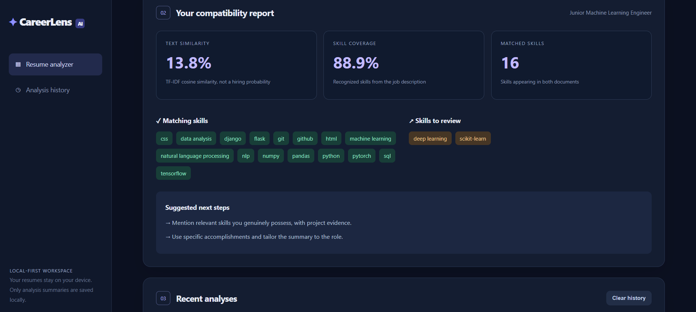
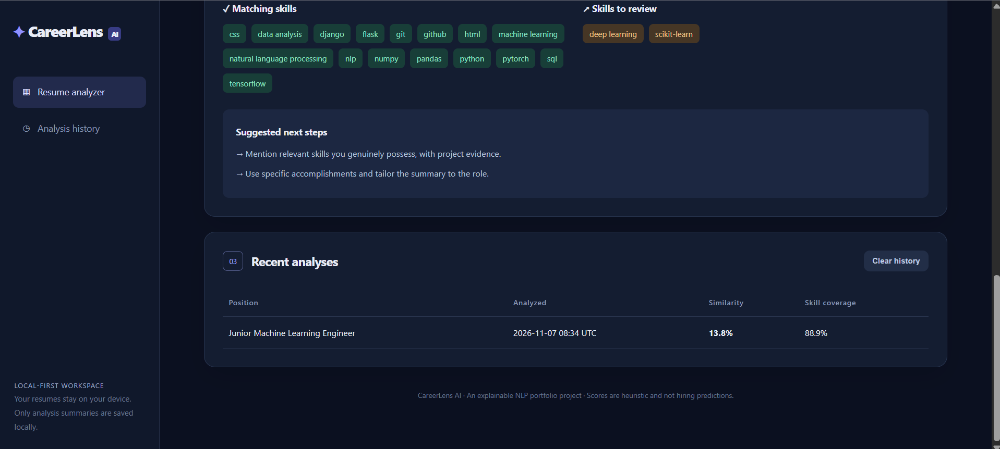

# CareerLens AI — Resume & Job Match Analyzer

A polished, **local-first NLP web application** that compares resumes with job descriptions, highlights skill gaps, and stores lightweight analysis history. Built with Python, Flask, SQLite, and scikit-learn.

## Features
- Paste resume text or upload **PDF / DOCX / TXT** (max 3 MB).
- Compare a resume and job description using **TF-IDF (unigrams and bigrams) and cosine similarity**.
- Extract recognized skills with transparent phrase matching and calculate skill coverage.
- Display skill gaps and actionable resume-improvement guidance.
- Keep local history of analysis scores and skill summaries; clear it at any time.
- Responsive, dark-themed dashboard.

> **Important:** Similarity is a heuristic lexical relevance score, **not** a calibrated hiring probability, an ATS score, or a prediction of employer decisions. This app does not use a generative LLM or claim semantic understanding beyond TF-IDF features. Skill extraction uses a curated dictionary and may miss synonyms or contextual meaning.

## Quick start (Windows / Python 3.10)
1. Extract the ZIP.
2. Double-click `run_windows.bat` (requires Python and internet for first dependency installation).
3. Open `http://127.0.0.1:5000` if it does not open automatically.
4. Paste a job description and a resume, or upload a resume file. Select **Analyze compatibility**.

### Manual setup
```powershell
py -3.10 -m venv .venv
.venv\Scripts\activate
python -m pip install -r requirements.txt
python app.py
```
Open `http://127.0.0.1:5000`.

### Run tests
```powershell
python -m unittest discover -s tests -v
```

## Privacy and limitations
- Uploaded documents are processed in memory; original documents and full job descriptions are **not** stored in SQLite. Analysis metadata is stored in `careerlens.sqlite3` on your computer.
- No third-party AI API, cloud account, or model training is required.
- PDF extraction requires selectable text; scanned PDFs need OCR, which is not included.
- This is a single-user local portfolio application. Do not expose the Flask server publicly without adding production authentication, CSRF protections, and deployment hardening.
- Do not insert skills into a resume unless you actually have them.

## Portfolio summary
**CareerLens AI — NLP Resume & Job Matching Platform** | Python, Flask, scikit-learn, SQLite, HTML/CSS

Designed and developed a local-first web application for resume-to-job-description analysis using TF-IDF vectorization and cosine similarity. Implemented skill extraction, gap identification, a responsive analytics dashboard, document parsing, and SQLite-based analysis history.

## Project structure
```
app.py                Flask application and NLP analysis
static/style.css      Responsive UI styling
templates/index.html  Dashboard template
tests/test_app.py     Automated unit and route tests
screenshots/          Demonstration screenshots for GitHub README
run_windows.bat       Windows launcher
requirements.txt      Dependencies
.gitignore            Git exclusions
```

## Screenshots
The screenshots below show a demonstration using a sample Junior Machine Learning Engineer job description and a resume. Scores are heuristic, not hiring predictions.

### 1. Dashboard


### 2. Resume and job description input


### 3. Compatibility report and skill analysis


### 4. Saved analysis history


## Suggested GitHub topics
`python` `flask` `nlp` `machine-learning` `resume-analyzer` `job-matching` `scikit-learn` `sqlite` `portfolio-project`
